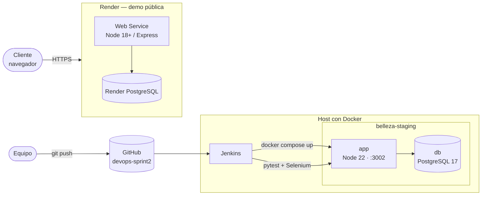
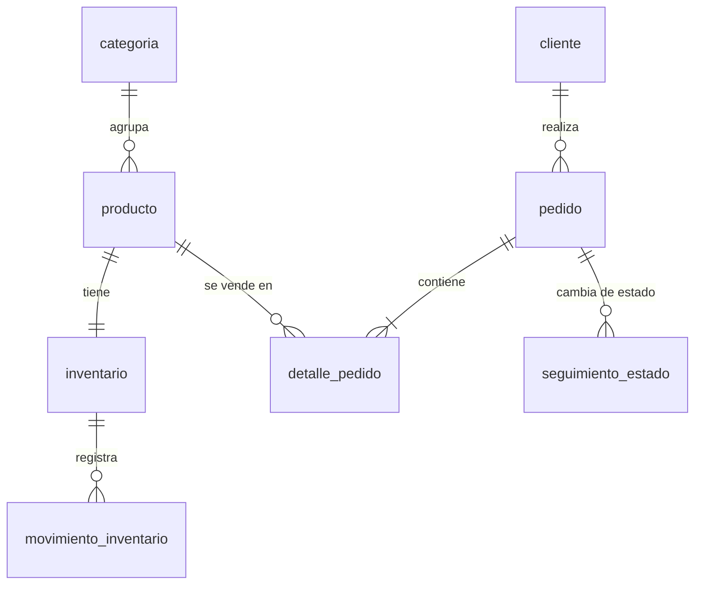
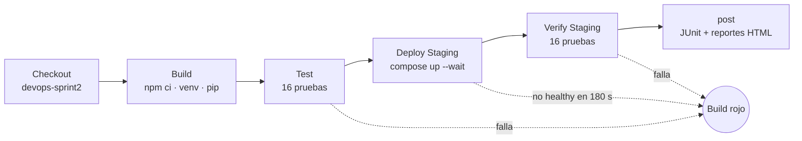

# Arquitectura final — Belleza Conceptual

Este documento describe la arquitectura que está implementada y desplegada al cierre del Sprint 2. Donde difiere del diseño de alto nivel de la Fase 1 (E2), se explica el porqué.

## 1. Vista general

La solución tiene **un servicio Node.js/Express** que publica el frontend y la API y **una base PostgreSQL**. Ese servicio corre en tres ambientes, y **Jenkins** automatiza la construcción, las pruebas y el despliegue a staging.

## 2. Componentes

| Componente | Tecnología | Responsabilidad |
|---|---|---|
| Frontend | HTML5, CSS y JavaScript sin framework (`index.html`) | Catálogo con filtros por categoría, carrito, formulario de datos y confirmación del pedido |
| API | Node.js + Express 4 (`server.js`) | Publica el frontend en `/`, expone `/health` y `/api/*` y valida los pedidos |
| Acceso a datos | `pg` (pool de conexiones) | Consultas parametrizadas. El pedido se registra en una transacción `BEGIN/COMMIT/ROLLBACK` que bloquea las filas de inventario (`FOR UPDATE`) para evitar sobreventa entre pedidos simultáneos |
| Base de datos | PostgreSQL (18 en Render, 17 en staging) | 8 tablas con integridad referencial; `CHECK` impide inventario negativo y cantidades ≤ 0 |
| Pruebas | pytest, requests, Selenium, pytest-html | 16 pruebas de API, seguridad, rendimiento y E2E |
| Contenedores | Docker y Docker Compose | Imágenes de app y base, healthchecks y volumen persistente |
| CI/CD | Jenkins (pipeline declarativo) | Checkout → Build → Test → Deploy Staging → Verify Staging |

## 3. Ambientes

| | Local | Staging | Demo pública |
|---|---|---|---|
| Ejecución | `npm start` | Docker Compose (`compose.staging.yaml`) | Render Web Service |
| Base | PostgreSQL local | Contenedor PostgreSQL 17 con volumen `staging_data` | Render PostgreSQL |
| URL | `http://localhost:3002` | `http://localhost:3003` (host), `http://belleza-staging-app-1:3002` (red Docker) | `https://belleza-conceptual.onrender.com` |
| `DB_SSL` | `false` | `false` | `true` |
| Despliegue | manual | Jenkins, etapa Deploy Staging | manual desde Render |
| Datos iniciales | `schema.sql` + `seed.sql` a mano | automáticos al crear el volumen (`Dockerfile.db`) | `schema.sql` + `seed.sql` a mano |

## 4. API y reglas de negocio

| Endpoint | Requerimiento | Comportamiento |
|---|---|---|
| `GET /health` | RNF-04 | `200 {status:"ok", db:"up"}`, o `500 {db:"down"}` si falla la conexión |
| `GET /api/products` | RF-01, RF-09 | Solo productos activos, con categoría y `cantidad_disponible` |
| `POST /api/orders` | RF-03, RN-02, RN-03 | Valida cliente (nombre y teléfono), al menos un ítem y cantidades enteras > 0 (400 si no). Registra cliente, pedido, detalle, seguimiento de estado y movimiento de inventario en una sola transacción. Si falta existencia, el pedido queda marcado para revisión manual (`revision_requerida: true`) |
| `GET /api/orders/:codigo` | CU-03 | Pedido con su detalle, o 404 si el código no existe |

## 5. Modelo de datos implementado

Restricciones que protegen las reglas de negocio:

- `inventario.cantidad_disponible >= 0` cubre RNF-07 (el inventario nunca queda negativo).
- `detalle_pedido.cantidad > 0`.
- `movimiento_inventario.tipo_movimiento IN ('ENTRADA','SALIDA','AJUSTE')`.

## 6. Contenedores de staging

| Servicio | Imagen base | Puerto | Healthcheck | Depende de |
|---|---|---|---|---|
| `db` | `postgres:17-bookworm` + `schema.sql` y `seed.sql` en `docker-entrypoint-initdb.d` | 5432 (solo red interna) | `pg_isready` cada 5 s | — |
| `app` | `node:22-bookworm-slim`, `npm ci --omit=dev`, usuario `node` | 3002 → `127.0.0.1:3003` | `/health` con `db === "up"` cada 5 s | `db` sana |

Decisiones de seguridad:

- La app corre sin privilegios de root.
- La contraseña de la base solo existe en `.env.staging` (ignorado por git) y en la credencial `staging-db-password` de Jenkins.
- `.dockerignore` excluye `.env*`, `.git` y `node_modules`.
- La base no publica su puerto al host.

## 7. Pipeline de CI/CD

El detalle de configuración está en [LEEME-STAGING.md](../LEEME-STAGING.md#5-pipeline-de-jenkins).

## 8. Diferencias con el diseño de la Fase 1 (E2)

| Diseño E2 | Implementación final | Motivo |
|---|---|---|
| 4 microservicios (auth, catalog, orders, payments) | 1 servicio Express (`catalog-orders-service`) | Alcance del MVP: catálogo, carrito y pedidos. Un solo servicio simplifica despliegue y red en el plan gratuito |
| Frontend React / Next.js | HTML + JavaScript sin framework | Se sirve desde el mismo Express sin un build de frontend |
| Redis 7 como caché | Sin caché | El volumen de datos no la justifica; PostgreSQL responde dentro del umbral de rendimiento |
| 17 entidades | 8 tablas | Solo las entidades del flujo implementado. Usuarios, roles, pagos, entregas y notificaciones dependen del panel administrativo, pendiente |
| Azure App Service + Azure Pipelines | Render (demo) + Jenkins con Docker (staging) | Plan gratuito disponible y requisito del Sprint 2 de usar Jenkins |

Estos cambios reducen el alcance pero no las reglas críticas: la validación de existencias, la transacción del pedido y el inventario no negativo se conservan.

## 9. Limitaciones conocidas

- **Sin panel administrativo.** RF-05, RF-06, RF-07, RF-08 y RF-10 no están implementados.
- **Render gratuito.** El servicio se suspende por inactividad y la instancia PostgreSQL tiene vigencia limitada.
- **Staging local.** Solo es accesible desde el host de Docker.
- **Etapa Test del pipeline.** Prueba la versión desplegada antes del build; la verificación de la versión nueva la hace Verify Staging.
- **Migraciones.** Los cambios al esquema no se aplican en un volumen existente; no hay herramienta de migraciones.
