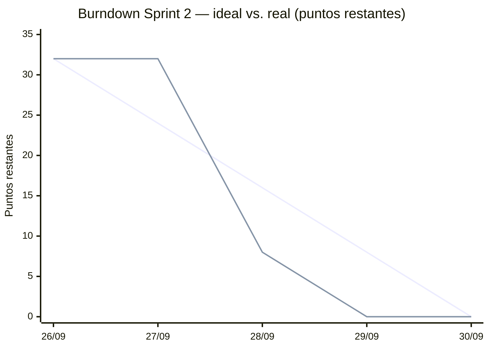

# Scrum — Sprint 2: Automatización de pruebas y CI/CD

| | |
|---|---|
| Proyecto | Belleza Conceptual — tienda en línea B2C |
| Sprint | 2 |
| Periodo | 26/09/2026 – 30/09/2026 [confirmar fechas] |
| Rama | `devops-sprint2` |
| Product Owner | Omar Haffid Espina Sarceño (también Líder de Grupo) |
| Scrum Master | Angel Estuardo Barrios Gómez |
| Development Team | Juan Carlos Pineda Bran · David Eduardo Romero Gerónimo (QA) |

Las fechas y autores de las tareas técnicas salen del historial de commits de `devops-sprint2`. Los campos entre corchetes `[__]` son datos que solo el equipo conoce y deben completarse antes de entregar.

---

## 1. Sprint Goal

> **Automatizar la verificación de la tienda en línea: 16 pruebas automatizadas que se ejecutan en un pipeline de Jenkins, el cual despliega la aplicación en un staging Docker con PostgreSQL y la valida en cada build.**

El objetivo se cumple si:

1. El pipeline ejecuta Checkout → Build → Test → Deploy Staging → Verify Staging.
2. Hay una ejecución positiva (verde), una negativa (roja, con defecto registrado) y una posterior a la corrección (verde).
3. La documentación técnica y Scrum está actualizada en el repositorio.

## 2. Sprint Backlog

| ID | Historia / tarea | Responsable | Pts | Estado | Evidencia |
|---|---|---|---|---|---|
| SB-01 | Pruebas de API con pytest (4) | Angel Barrios | 3 | Hecho | `9057cea` — `tests/test_api.py` |
| SB-02 | Pruebas de validación y seguridad (6) | Angel Barrios | 3 | Hecho | `9057cea` — `tests/test_security.py` |
| SB-03 | Pruebas de rendimiento (2) | Angel Barrios | 2 | Hecho | `9057cea` — `tests/test_performance.py` |
| SB-04 | Pruebas E2E con Selenium (4) y ajuste para headless | Angel Barrios | 5 | Hecho | `9057cea`, `fe188ad` — `tests/selenium/` |
| SB-05 | Pipeline Jenkins: Checkout, Build y Test | Angel Barrios | 3 | Hecho | `c37b978` — `Jenkinsfile` |
| SB-06 | Staging Docker: Dockerfile, Dockerfile.db, Compose con PostgreSQL 17 y healthchecks | Juan Carlos Pineda | 5 | Hecho | `d0f59c9` — `compose.staging.yaml` |
| SB-07 | Etapas Deploy Staging y Verify Staging; pipeline Linux y variante Windows | Juan Carlos Pineda | 3 | Hecho | `d0f59c9` — `Jenkinsfile`, `Jenkinsfile.windows` |
| SB-08 | Ejecución positiva, negativa y corrección en Jenkins | [responsable] | 3 | Hecho | Builds #[__], #[__], #[__] |
| SB-09 | Documentación técnica: README, LEEME-STAGING, arquitectura y plan de pruebas | Omar Espina | 3 | Hecho | `README.md`, `LEEME-STAGING.md`, `docs/` |
| SB-10 | Artefactos Scrum del sprint | Omar Espina | 2 | Hecho | `docs/SCRUM-SPRINT-2.md` |
| | **Total** | | **32** | | |

Los puntos son una estimación relativa de esfuerzo (escala Fibonacci); ajústenlos si en la Planning usaron otros.

### Historias de usuario del sprint

- **HU-S2-01.** Como **equipo de desarrollo**, quiero que las pruebas del flujo de compra se ejecuten solas, para detectar regresiones sin probar a mano (SB-01 a SB-04).
- **HU-S2-02.** Como **equipo de desarrollo**, quiero un ambiente de staging idéntico en cada despliegue, para validar la versión antes de publicarla (SB-06).
- **HU-S2-03.** Como **Product Owner**, quiero que cada build despliegue y verifique staging automáticamente, para saber si el incremento está listo (SB-05, SB-07, SB-08).

**Criterios de aceptación:**

- Dado un push a `devops-sprint2`, cuando Jenkins ejecuta el pipeline, entonces las cinco etapas corren en orden y publican los reportes.
- Dado que una prueba falla, cuando corre Test o Verify Staging, entonces el build queda en rojo y no se da por válido el despliegue.
- Dado que `db` no está sana en 180 s, cuando corre Deploy Staging, entonces el build falla.

### Definición de Hecho

Código en `devops-sprint2` · pipeline en verde · 16/16 pruebas aprobadas en Verify Staging · evidencia (captura o reporte) archivada · documentación actualizada.

## 3. Daily Scrum

**Formato:** 15 minutos, [hora y medio: presencial, Teams, WhatsApp], facilitado por el Scrum Master. Cada integrante responde: ¿qué hice ayer?, ¿qué haré hoy? y ¿qué me bloquea?

| Fecha | Integrante | Ayer | Hoy | Impedimentos |
|---|---|---|---|---|
| 26/09 | Todos | Cierre de Fase 1 (entrega 25/09) | Sprint Planning: objetivo, backlog y responsables | [__] |
| 27/09 | [__] | [__] | [__] | [__] |
| 28/09 | Angel Barrios | Definición de la suite de pruebas | Pruebas pytest y Selenium (SB-01 a SB-04) y pipeline inicial (SB-05) | Selenium en modo headless para Jenkins, resuelto en `fe188ad` |
| 28/09 | Juan Carlos Pineda | [__] | Staging Docker y etapas de despliegue (SB-06, SB-07) | Jenkins necesita acceso al motor Docker y a la red de staging |
| 28/09 | Omar Espina | [__] | Revisión del backlog y del incremento | [__] |
| 28/09 | David Romero | [__] | [__] | [__] |
| 29/09 | [responsable SB-08] | Pipeline completo | Ejecución positiva, negativa y corrección (SB-08) | [__] |
| 29/09 | Omar Espina | Revisión del pipeline | Documentación técnica y Scrum (SB-09, SB-10) | — |
| 30/09 | Todos | [__] | Sprint Review y Retrospectiva | [__] |

## 4. Burndown

Puntos pendientes al cierre de cada día (32 en total):

| Día | 26/09 | 27/09 | 28/09 | 29/09 | 30/09 |
|---|---|---|---|---|---|
| Ideal | 32 | 24 | 16 | 8 | 0 |
| Real | 32 | 32 | 8 | 0 | 0 |
| Completado en el día | — | — | SB-01 a SB-07 (24 pts) | SB-08, SB-09, SB-10 (8 pts) | Review y Retro |

La primera línea es la ideal y la segunda la real. La real se mantiene plana dos días y cae de golpe el 28/09: casi todo el trabajo técnico se integró ese día (4 commits entre 17:42 y 21:36). La consecuencia es que el riesgo se concentró al final: si algo fallaba el 28, quedaba poco margen. Queda como punto de la retrospectiva.

SB-08 se registró el 29/09; si la ejecución negativa fue el 28/09, muevan esos 3 puntos a ese día.

## 5. Sprint Review

**Fecha:** [__/09/2026] · **Asistentes:** equipo completo y [catedrático / revisor]

### Incremento demostrado

1. Push a `devops-sprint2` → Jenkins ejecuta las cinco etapas.
2. Deploy Staging levanta `app` y `db`; ambos quedan *healthy* y `/health` responde `db: up`.
3. Verify Staging ejecuta las 16 pruebas contra la versión nueva: 16/16 aprobadas y reportes JUnit y HTML publicados.
4. Ejecución negativa: [prueba que falló] detiene el build en [etapa].
5. Corrección y nueva ejecución en verde.

### Resultado contra el objetivo

| Criterio del Sprint Goal | Resultado |
|---|---|
| Pipeline de 5 etapas | Cumplido |
| 16 pruebas automatizadas en el pipeline | Cumplido |
| Staging Docker + PostgreSQL | Cumplido |
| Ejecución positiva, negativa y corrección | Cumplido — builds #[__], #[__], #[__] |
| Documentación actualizada | Cumplido |

**Sprint Goal: cumplido.** Puntos completados: 32 de 32.

### Retroalimentación recibida

- [__]

### Ajustes al Product Backlog

| Nuevo ítem | Origen |
|---|---|
| Mover la verificación de la etapa Test para que no pruebe la versión anterior (o eliminar Test y dejar solo Verify Staging) | Revisión del pipeline |
| Prueba automatizada de pedido válido (201) que verifique el descuento de inventario | Brecha del plan de pruebas |
| Alinear `MAX_RESPONSE_SECONDS` con RNF-02 (4 s) y RNF-03 (2 s) | Brecha del plan de pruebas |
| Panel administrativo (RF-05 a RF-08, RF-10) | Pendiente desde la Fase 1 |

## 6. Retrospectiva

**Fecha:** [__/09/2026] · **Facilita:** Angel Barrios (Scrum Master)

| Qué funcionó (continuar) | Qué mejorar (empezar) | Qué dejar de hacer |
|---|---|---|
| Una sola suite parametrizada con `BASE_URL`, que sirve para local, staging y Render sin cambios | Repartir la integración a lo largo del sprint; todo entró el 28/09 | Dejar documentos desactualizados: `LEEME-STAGING` decía que el pipeline era de Windows y que no había resultados de las 16 pruebas |
| Healthchecks en Compose: el deploy falla solo si la base o la app no arrancan | Registrar cada fallo de Jenkins como defecto con su build, como en la Fase 1 | Tener el Checkout del Jenkinsfile apuntando a un fork distinto del repositorio principal |
| Secretos fuera del repositorio (`.env.staging`, credencial de Jenkins) | Actualizar la documentación en el mismo commit que el código | Correr la etapa Test contra la versión anterior sin aclararlo |

### Acciones para el siguiente sprint

| # | Acción | Responsable | Criterio de cierre |
|---|---|---|---|
| 1 | Unificar el origen del Checkout con el repositorio principal | [__] | El Jenkinsfile clona el mismo repositorio que dispara el job |
| 2 | Reordenar o eliminar la etapa Test | [__] | Ninguna etapa prueba una versión distinta a la del build |
| 3 | Integrar a diario en lugar de al final | Scrum Master | El burndown baja al menos un ítem por día |
| 4 | Agregar la prueba de pedido válido y ajustar los umbrales de rendimiento | [__] | 17+ pruebas en verde |
